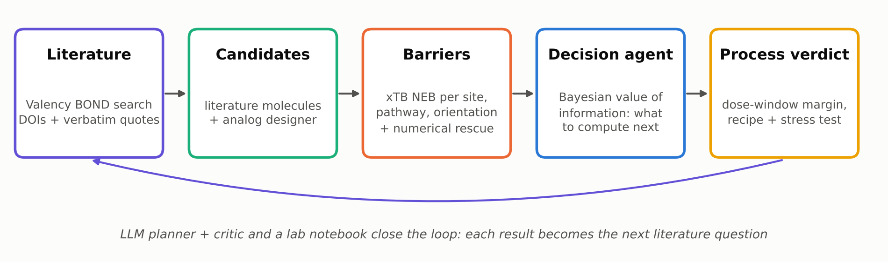
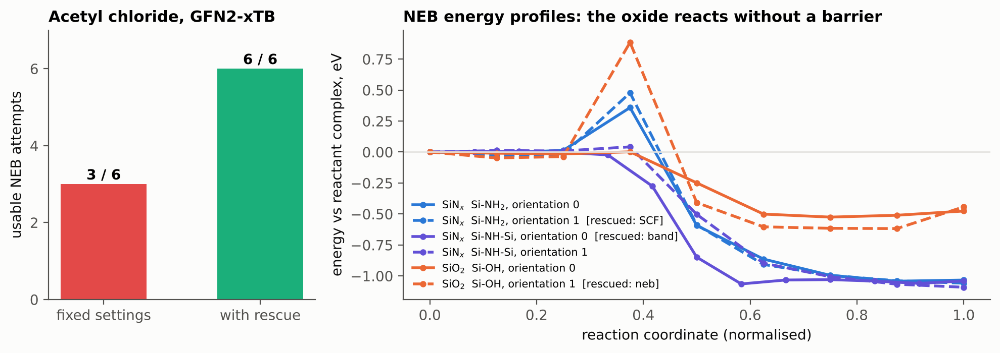
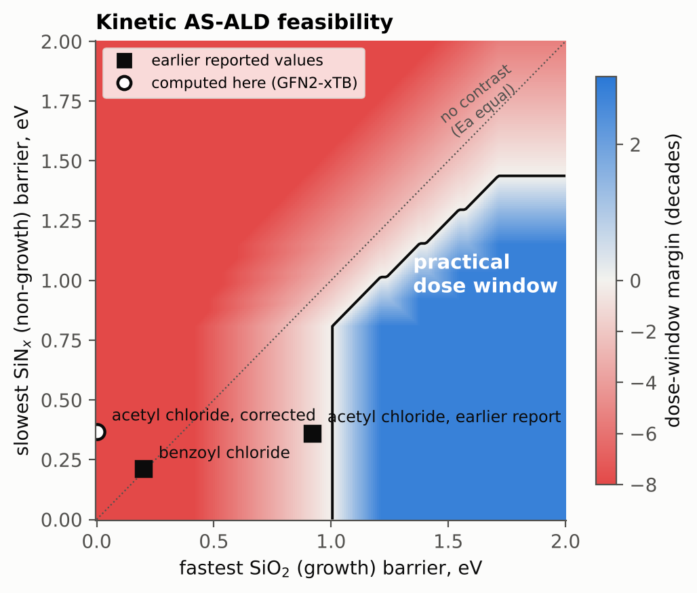

# WARDEN: an AI co-scientist that decides what to compute next for area-selective ALD

**WARDEN is an in-silico co-scientist for area-selective atomic layer deposition (AS-ALD). It searches the literature, proposes inhibitor molecules, models how each one reacts with amorphous SiO₂ and SiNₓ surfaces, and decides which calculation is worth running next. Every step answers one physical question: can a practical dose cap every nitride site before it caps the oxide?** The target is the 3D-NAND step of growing SiO₂ on SiO₂ beside SiNₓ with 90 % selectivity at 10 nm. Code: [github.com/dominicvarghese/donuman-ai-scientist](https://github.com/dominicvarghese/donuman-ai-scientist).

**Why it helps.** Inhibitors are usually chosen by intuition and judged by adsorption energy on one idealised surface. But amorphous surfaces have many site types, reactions have several pathways, calculations fail for numerical reasons, and a strong preference does not guarantee a workable dose. Molecules × sites × pathways is too large to compute exhaustively. WARDEN tracks what is known and uncertain, spends compute only where it can change the decision, sources every claim, and records why each molecule passes or fails. Each model inside it can be replaced by a better one as data arrives.

## Approach

1. **Literature to candidates.** An LLM planner searches papers through Valency BOND and proposes molecules, each quoting a retrieved paper verbatim (DOI recorded). An independent critic reviews every proposal, and a deterministic designer makes analogs.
2. **Realistic surfaces.** Amorphous SiO₂ and SiNₓ slabs (generated, or the published Kim *et al.* structures) must pass gates on geometry, coordination, density and exposed-site density before any energy is computed.
3. **Barriers.** GFN2-xTB nudged-elastic-band calculations give the barrier $E_a$ for each site, pathway and orientation. A downhill band is a fast, barrierless reaction. A numerical failure gets one targeted retry and never counts against the molecule.
4. **One decision criterion.** A site is capped at rate $k=\frac{k_BT}{h}e^{-E_a/k_BT}$. A molecule works only if the *slowest* nitride site is 99 % capped before the *fastest* oxide site reaches 1 %, within practical doses of 0.05–30 s. The margin

$$m=\max_T\Big[\min\big(\log_{10}t_{1\%}^{\mathrm{SiO_2}},\log_{10}30\big)-\max\big(\log_{10}t_{99\%}^{\mathrm{SiN_x}},\log_{10}0.05\big)\Big]$$

counts how many decades of dose separate the two, at the best temperature. A process model turns the barriers into $P(S\ge0.9)$ at 10 nm, where $S=\frac{T_{GS}-T_{NGS}}{T_{GS}+T_{NGS}}$.

5. **The decision agent.** A Bayesian belief covers every barrier that could be computed. Each step the agent values every option (new molecule, site, pathway, orientation, or a more accurate method) as expected improvement in $m$ × chance of success ÷ cost, and stops when confident. A lab notebook feeds each outcome back to the planner.

## Results

**Validation of the workflow**

- **Catching a false positive.** Our first screen reported acetyl chloride as nitride-selective ($\Delta E_a=+0.71$ eV), because a fast oxide path had been discarded as a failed calculation. Treated as a barrierless reaction, that path gives a margin of −13.6 decades: no selectivity.
- **Reliable calculations.** With fixed settings, 3 of 6 NEB attempts on acetyl chloride failed numerically. With targeted retries, 6 of 6 gave usable results (figure below).
- **Choosing what to compute.** On 40 synthetic test cases per budget, the agent's final pick was 2.5 ± 0.7 decades better than screening every molecule cheaply at a budget of 20 calculations. At a budget of 80 it matched exhaustive screening with 16 % less compute.
- **Literature to candidates.** Ten papers retrieved with Valency gave five candidates. After acetyl chloride failed, the agent ranked aldehydes ([Langmuir 2021](https://doi.org/10.1021/acs.langmuir.1c00212)) above another acyl chloride.

**Candidate screening** — *[[RESULTS PENDING: per-candidate barriers and dose-window margins for pivaldehyde, glutaraldehyde, propanoyl chloride and the BDMADMS control; regenerate the map with `python submission/make_figures.py <db> <benchmark_dir>`]]*

*[[RESULT: best candidate, its margin $m$ and predicted $P(S\ge0.9)$ at 10 nm, or why no candidate passes yet]]*

## Next steps

WARDEN already turns "which molecule?" into a sourced, quantitative and repeatable decision, and each verdict shows which input limits it. Its physics improves as data arrives. Next: move the leading candidates from gas-phase site models onto the amorphous slabs, and verify them with DFT, which also corrects xTB's bias inside the agent. Then automate the literature loop (similar and citing papers, reported barriers as priors), add reaction types such as ring-opening silanes and ABC cycles ([ACS Nano 2017](https://doi.org/10.1021/acsnano.7b04701)), and calibrate the process model against measured growth curves.
